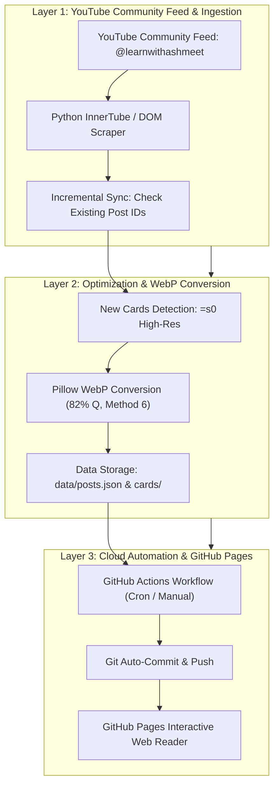

<div align="center">

# 📚 Learn with Ashmeet — Visual English Archive & Web Reader

### *High-Resolution, Zero-Dependency Interactive Community Cards Reader & Auto-Sync Engine*

[](https://github.com/Upendra8127/LWApost/actions)
[](SECURITY.md)
[](SECURITY.md)
[](LICENSE)
[](tests/core.test.js)
[](manifest.json)
[](.github/workflows/lighthouse.yml)
[](https://conventionalcommits.org)
[](https://github.com/prettier/prettier)
[](CONTRIBUTING.md)

<p align="center">
  A progressive visual reader web app and automated cloud sync archiver for English vocabulary, pronunciation, grammar, and idioms community post cards from YouTube creator <strong>Learn with Ashmeet</strong>.
</p>

</div>

---

## 🧭 Navigation Matrix

| Documentation | Specification & Governance | Developer Resources |
| ------------- | -------------------------- | ------------------- |
| [Web Reader Features](#-web-reader-features) | [Governance Model](GOVERNANCE.md) | [Contributing Guidelines](CONTRIBUTING.md) |
| [Dataset Metrics](#-dataset-metrics) | [Security Policy](SECURITY.md) | [Support Portal](SUPPORT.md) |
| [Cloud Auto-Sync](#-free-cloud-automation-github-actions) | [Product Roadmap](ROADMAP.md) | [Release Changelog](CHANGELOG.md) |
| [Architecture](#-system-architecture) | [Academic Citation](CITATION.cff) | [MIT License](LICENSE) |

---

## 🚀 Web Reader Features

The reader is a pure Vanilla HTML5/CSS3/ES6+ Progressive Web App (PWA) designed for seamless reading on mobile and desktop:

1. **🕒 Live Sync & "Last Updated" Status**: Prominently displays the exact timestamp of the last automated sync.
2. **🔥 "New Posts" Tracking & Filtering**: Real-time counter showing newly added posts with an instant one-click filter and `NEW` badges.
3. **📅 Interactive Calendar & Date Filter**:
   - Quick presets: *Today*, *Past 7 Days*, *Past 30 Days*, *Past 3 Months*, *Past 6 Months*.
   - Custom Date Range: pick specific *From* and *To* dates using native calendar pickers.
4. **🔽 Multi-Criteria Sorting**:
   - 🔽 *Newest First* (Default)
   - 🔼 *Oldest First*
   - ❤️ *Most Liked*
   - 🃏 *Most Cards* (Multi-card carousels first)
5. **🔍 Instant Search**: Real-time filter across all post captions and vocabulary terms (e.g., "opposites", "pronunciation", "phrases").
6. **⭐ Saved Bookmarks**: Bookmark cards to study or revise later (persisted across sessions via `localStorage`).
7. **📖 Full-Screen Slideshow Reader**:
   - High-resolution unscaled WebP cards.
   - Arrow keys, on-screen controls, and touch swipe gestures on mobile.
   - Dot pagination indicators and card counter (e.g. `Card 2 of 6`).
   - Lesson notes & context drawer with single-click "Copy Text".
   - Direct link to original YouTube post.
8. **🌓 Theme Toggle & PWA Offline**: Dark and light modes with service worker offline caching.

---

## ⚡ System Architecture



---

## 📊 Dataset & Compression Metrics

| Metric | Original Archive | Compressed Web Reader | Reduction / Status |
| ------ | :--------------: | :-------------------: | :----------------: |
| **Total Posts** | 222 Posts | 222 Posts | 100% Complete |
| **Total Cards** | 1,162 Cards | 1,162 Cards | 100% Preserved |
| **Average File Size** | ~1.8 MB (PNG) | **~120 KB (WebP)** | **93.0% Storage Reduction** |
| **Total Media Size** | 2,045 MB | **144 MB** | **Under GitHub 100MB per-file limit** |
| **Visual Quality** | 1254 x 1254 px | 1254 x 1254 px | Visually Lossless (Sharp text) |

---

## 🤖 Free Cloud Automation (GitHub Actions)

The repository includes a 100% free automated sync workflow located in [`.github/workflows/auto_sync.yml`](.github/workflows/auto_sync.yml):
* **Automatic Schedule**: Runs automatically every 2 days at 04:00 AM UTC.
* **On-Demand Trigger**: Click **Run workflow** in the GitHub Actions tab anytime to sync immediately.
* **Smart Incremental Append**: Only new posts published since the last run are downloaded, compressed to WebP, and appended to the reader.
* **Automatic Deployment**: Pushes the update directly to GitHub, instantly refreshing the GitHub Pages site.

---

## 🌐 How to Host on GitHub Pages (2 Simple Steps)

1. **Push this repository to GitHub**:
   ```bash
   git init
   git add .
   git commit -m "feat: initial commit of LWA visual archive and web reader"
   git branch -M main
   git remote add origin https://github.com/<your-username>/LWApost.git
   git push -u origin main
   ```
2. **Enable GitHub Pages**:
   - Go to your repository on GitHub.
   - Click **Settings** ➔ **Pages** (under Code and automation).
   - Under **Build and deployment** ➔ **Source**, select **Deploy from a branch**.
   - Select branch: `main` and folder: `/ (root)`, then click **Save**.
   - Within 1 minute, your interactive web reader is live at:
     ```
     https://<your-username>.github.io/LWApost/
     ```

---

## 🔬 Testing & Quality Verification

Run the zero-dependency test suite:
```bash
node --test tests/*.test.js
```
Validate dataset integrity:
```bash
node scripts/validate.js
```

---

## 📜 Governance & Maintainers

Maintained by **Upendra Yadav** ([@Upendra8127](https://github.com/Upendra8127)) under the [MIT License](LICENSE).
Report security concerns through [SECURITY.md](SECURITY.md).
